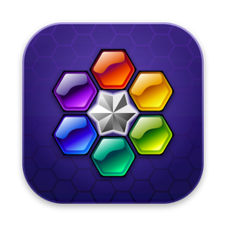

<p align="center">
  
</p>

<h1 align="center">Hexic HD for macOS and Windows</h1>

<p align="center">
  An unofficial preservation port of the Xbox 360 Live Arcade puzzle game <i>Hexic HD</i> (Carbonated Games / Microsoft Game Studios, 2005), playable as a native desktop app.
</p>

---

Hexic HD never came to PC. Under the hood, though, the Xbox 360 game is a Flash file (`HexicDeluxe.swf`) running inside a thin Xbox shell. This project keeps that original game file and:

- **runs it in [Ruffle](https://ruffle.rs)**, the open-source Flash Player emulator;
- **patches it** so it works without the Xbox: sound, saves, leaderboards, controls and text rendering;
- **wraps it** in a desktop app for macOS (Apple Silicon and Intel) and Windows (x64).

The game logic, artwork and animations are the original's. This is not a remake.

> [!IMPORTANT]
> There are two ways to play:
> - **Download a ready-made build** from [Releases](../../releases).
> - **Build it yourself** from your own copy of Hexic HD (see [Building](#building)). The source code in this repository contains no game files.
>
> Hexic and Hexic HD are trademarks of Microsoft. This project is not affiliated with or endorsed by Microsoft or Carbonated Games.

## Features

- The full original game: Marathon, Timed and Survival modes, three difficulties, tutorials and options.
- **Saves and settings** persist between launches. "Resume your game?" works as on the Xbox.
- **Local leaderboards** replace Xbox Live, with a top 100 per mode. Your entry is named after your computer's user account.
- **The soundtrack** by Jerry Schroeder plays shuffled, at the game's own music volume.
- **Keyboard, mouse and controller** support.
- **Console-accurate presentation:** fonts, text sizes and the main menu layout were matched against footage of the original Xbox 360 game.
- Fullscreen with the correct 16:9 aspect ratio.

## Controls

The game was designed for an Xbox controller. Every button has a keyboard equivalent, and the mouse works in the menus.

| Action | Keyboard | Controller |
|---|---|---|
| Move the cursor / menu selection | Arrow keys | D-pad or left stick |
| Rotate clockwise / select | **A**, Space or Enter | A |
| Rotate counter-clockwise | **X** or Z | X |
| Rotate counter-clockwise / clockwise | **L** / **R** | LB / RB |
| Back | **B**, Esc or Backspace | B, Back |
| Pause | **S** or P | Start |
| Leaderboards (main menu or pause screen) | **Y** | Y |
| Fullscreen | F11 or Alt+Enter (⌃⌘F on macOS) | |

### Controller support

Controllers work over USB or Bluetooth through the standard Gamepad API. That covers Xbox, PlayStation, Switch Pro and most generic pads. Buttons are mapped by position, so on a PlayStation pad, Cross is A, Circle is B, Square is X and Triangle is Y. The left stick moves like the D-pad. You can switch between controller, keyboard and mouse at any time.

## Download

Get the latest build from [Releases](../../releases):

| Platform | File | Notes |
|---|---|---|
| macOS (Apple Silicon and Intel) | `Hexic.HD-1.0.0-universal.dmg` | Open it and drag *Hexic HD* to Applications |
| Windows (x64) | `Hexic.HD-1.0.0-portable.exe` | Single file, no install |
| Windows (x64) | `Hexic.HD-1.0.0-setup.exe` | Installer with Start menu shortcut |
| Windows (x64) | `Hexic.HD-1.0.0-win-x64.zip` | Unzip and run `Hexic HD.exe` |

The builds aren't code-signed:
- **macOS:** the first time, right-click the app and choose **Open**.
- **Windows:** if SmartScreen appears, click **More info**, then **Run anyway**.

## Building

Builds run on **macOS**, which makes both the Mac and the Windows versions.

### 1. Requirements

- [Homebrew](https://brew.sh) packages: `brew install python ffmpeg openjdk node`
- The Hexic HD game files from your own copy, copied into the `original/` folder ([its README](original/README.md) lists every file). The build needs:
  - `HexicDeluxe.swf`
  - `KeyMap_HXIC.xml`
  - `g.xml` and the other `*_g.xml` / `*_k.xml` localisation files
  - the soundtrack `*.wma` files
  - `convectionui.ttf` and `xarialuni.ttf`

### 2. Build

```sh
./tools/fetch_vendor.sh          # downloads Ruffle, JPEXS and fonts at pinned versions
./tools/build_web.sh             # original/ -> build/www (patched game, music, fonts, Ruffle)
cd platforms/desktop
npm ci
npm run dist                     # dist/macos and dist/windows
```

If your terminal sets `ELECTRON_RUN_AS_NODE`, which some Electron-based editors do, run `npm` commands as `env -u ELECTRON_RUN_AS_NODE npm …`. To play without packaging, run `npm start`.

### 3. Output

| Platform | File | Notes |
|---|---|---|
| macOS | `dist/macos/Hexic HD-1.0.0-universal.dmg` (or `.zip`) | Drag *Hexic HD* to Applications |
| Windows | `dist/windows/Hexic HD-1.0.0-portable.exe` | Single file, no install |
| Windows | `dist/windows/Hexic HD-1.0.0-setup.exe` | Installer with Start menu shortcut |
| Windows | `dist/windows/Hexic HD-1.0.0-win-x64.zip` | Unzip and run `Hexic HD.exe` |

The builds aren't code-signed:
- **macOS:** the first time, right-click the app and choose **Open**.
- **Windows:** if SmartScreen appears, click **More info**, then **Run anyway**.

### Where saves live

| Platform | Folder |
|---|---|
| macOS | `~/Library/Application Support/Hexic HD` |
| Windows | `%APPDATA%\Hexic HD` |

## How it works

The Xbox 360 game was a Flash 6 (ActionScript 2) movie hosted by a native Xbox program, which handled saving, Xbox Live, music, input and text rendering. The build recreates those pieces:

| The Xbox did | This port does |
|---|---|
| Decoded the sound effects (XMA, an Xbox-only codec) | Converts them to standard PCM inside the game file (`tools/convert_sounds.py`) |
| Stored settings and saved games in the player's profile | Stores them through Flash's own local storage (`patches/inject/frame1_host.as`) |
| Xbox Live leaderboards | A local high-score table using the game's own leaderboard screens |
| Played the WMA soundtrack | The app plays it as Ogg/Opus (`platforms/desktop/web/host.js`) |
| Delivered controller buttons as key codes | Maps keyboard, mouse and gamepad onto those codes |
| Drew text with its own fonts and sizing rules | Rebuilds the console's stripped Arial (`tools/repair_xbox_font.py`) and emulates its text sizing and alignment |

The main menu uses the layout of the later Xbox title update: a taller panel and a Leaderboards entry (`tools/menu_layout.py`). The game file is patched at build time with [JPEXS](https://github.com/jindrapetrik/jpexs-decompiler), which recompiles the scripts in `patches/`. It is then packaged with [Electron](https://www.electronjs.org), which serves it from a private `app://` origin.

### Repository layout

| Path | Contents |
|---|---|
| `patches/` | ActionScript patches applied to the game file |
| `tools/` | Build scripts (`build_web.sh`, `build_swf.py`, `fetch_vendor.sh`, …) |
| `platforms/desktop/` | The Electron app for macOS and Windows, and its web host in `web/` |
| `platforms/anbernic/` | An experimental PortMaster port for Anbernic handhelds; see its [README](platforms/anbernic/README.md) |
| `docs/` | README images |

The folders `original/` (your game files), `vendor/`, `build/` and `dist/` are generated or private, and are not committed.

## Credits

- **Hexic HD:** Carbonated Games, published by Microsoft Game Studios. Soundtrack by Jerry Schroeder.
- **[Ruffle](https://ruffle.rs):** Flash Player emulator (MIT / Apache-2.0).
- **[JPEXS Free Flash Decompiler](https://github.com/jindrapetrik/jpexs-decompiler):** used at build time (GPL-3.0).
- **[Electron](https://www.electronjs.org)** and **[electron-builder](https://www.electron.build)** (MIT).
- **[Liberation Sans](https://github.com/liberationfonts/liberation-fonts):** fallback font (SIL OFL 1.1).
- The app icon is built from the game's own gem artwork by `tools/make_icon.py`.

## License

This project's code is released under the [MIT License](LICENSE). Hexic HD itself, including its game files, music and artwork, belongs to Microsoft and is not covered.
